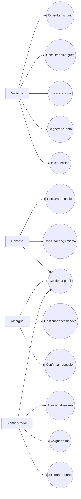
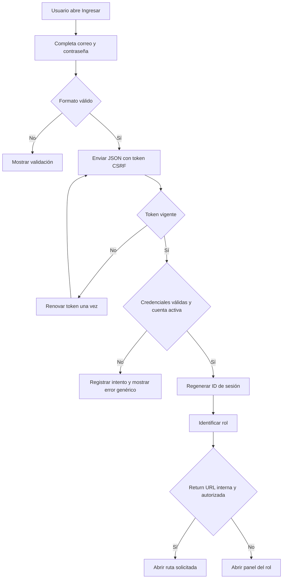
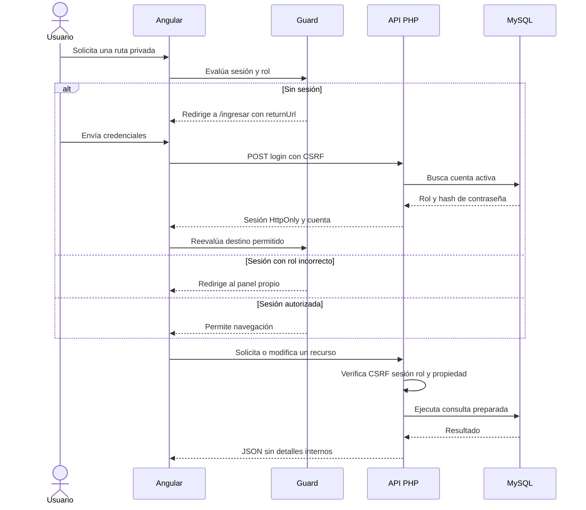
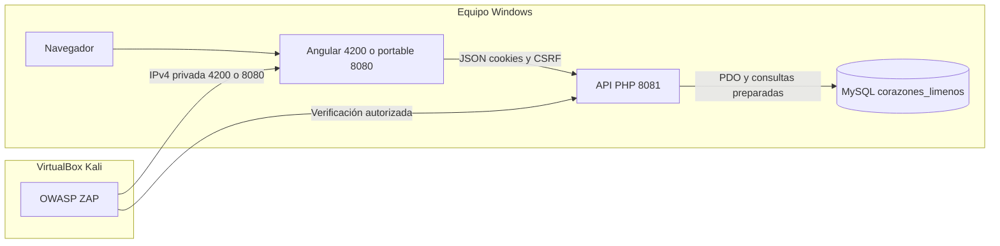

# Diagramas corregidos del sistema

Los diagramas representan la implementación actual de Corazones Limeños. La
autorización se valida en Angular para la navegación y se vuelve a comprobar en
la API antes de consultar o modificar información.

## Diagrama de casos de uso

## Actividad del inicio de sesión

## Secuencia de autenticación y autorización

## Arquitectura y despliegue para la demostración

## Matriz resumida de rutas

| Ruta | Público | Donante | Albergue | Administrador |
|---|:---:|:---:|:---:|:---:|
| `/`, `/albergues`, `/contacto` | Sí | Sí | Sí | Sí |
| `/donar` y subrutas | No | Sí | No | No |
| `/panel/donante` | No | Sí | No | No |
| `/panel/albergue` | No | No | Sí | No |
| `/panel/admin` | No | No | No | Sí |
| `/perfil` | No | Sí | Sí | Sí |

